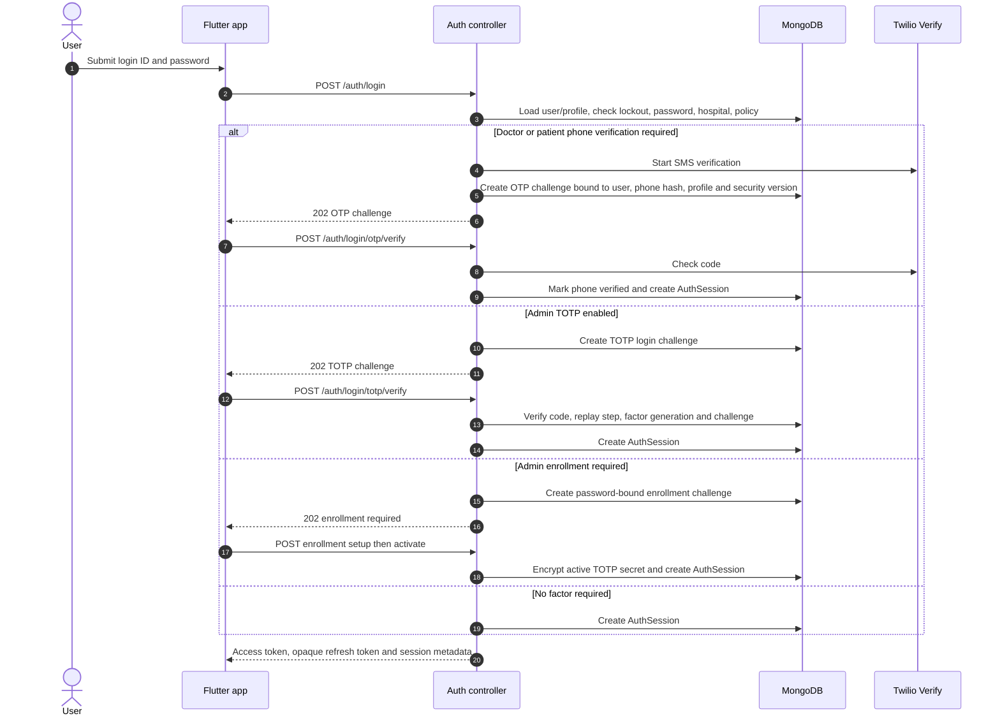
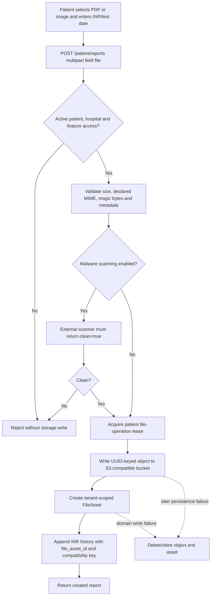
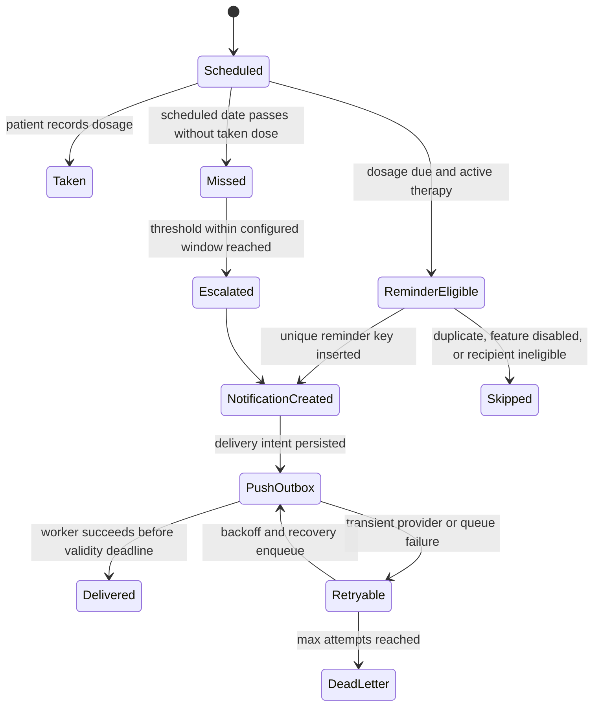
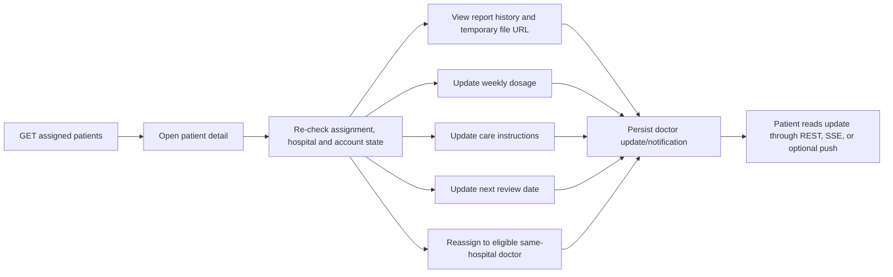
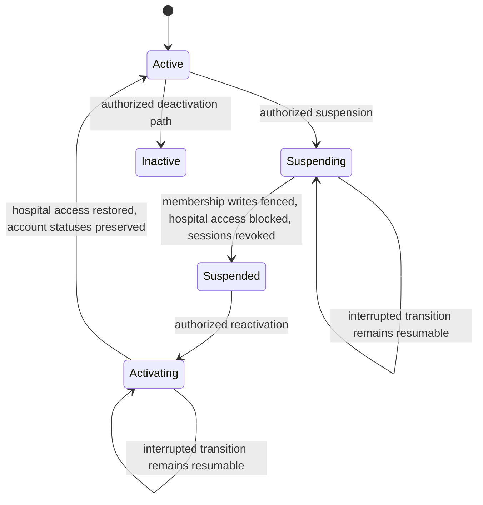
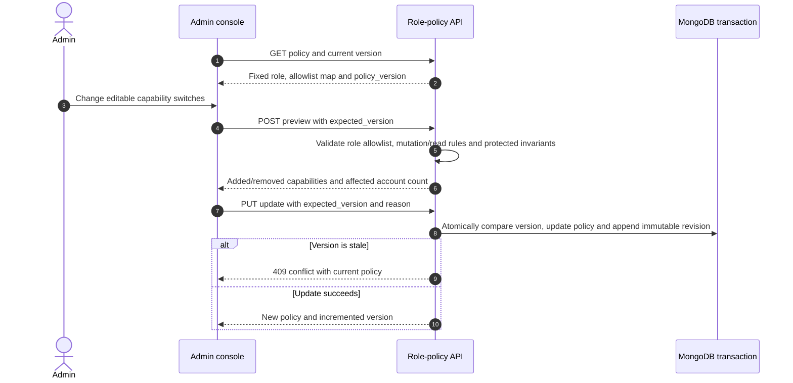
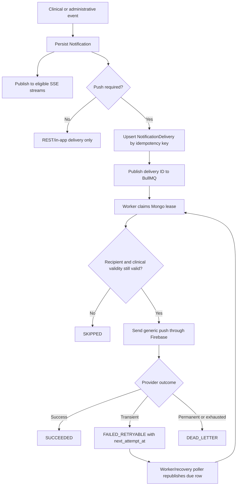
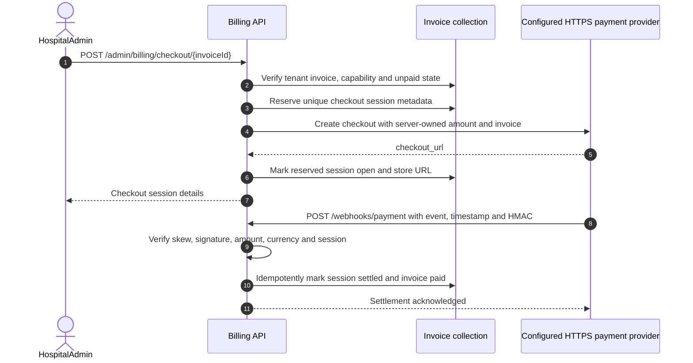
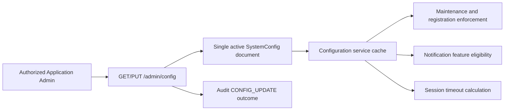

# Individual feature workflows

## Password, OTP, TOTP, and session issuance

The Flutter OTP form uses `resend_available_at`, remaining attempts, and max resends from the challenge payload. Resend stays disabled during cooldown or after the resend budget is exhausted; verify is blocked when the challenge is expired or has no attempts left.

When login returns `TOTP_ENROLLMENT_REQUIRED`, the Flutter login page loads password-bound setup material (QR code and setup key) and activates the factor with the six-digit authenticator code before a session is issued. Challenge expiry and lockout return the administrator to the password form; an invalid authenticator code stays on the enrollment form.

## Patient INR report upload

The Update INR form rejects empty, non-decimal, zero, and values above 20 before `POST /patient/reports`, matching `reportSchema`.

## Dosage adherence and reminders

## Doctor review and care-plan update

## Hospital and account lifecycle

Hospital lifecycle uses a lease and monotonic generation. Doctor lifecycle and patient assignment use related leases/fences so stale workers cannot safely resume after losing ownership.

## Administrator role-policy change

## Notification delivery

## Billing checkout and settlement

The provider brand and live endpoint are configuration, not source-backed facts.

## Runtime configuration and feature flags

### Administrator data loading states

Analytics, personal MFA, platform configuration, and hospital operations health distinguish a first-load failure from an empty result. A failed first load shows an error and an explicit retry. When a refresh fails after data loaded successfully, the page keeps that data visible, labels it as stale with its last successful load time, and shows the refresh error with a retry action. Configuration does not schedule another initial request after a failure; the administrator retries explicitly. Analytics section-level authorization denials remain distinct from request failures, and empty charts are shown only after the aggregate query succeeds.

### Lifecycle commit and recovery

Individual Doctor/Patient status routes, legacy deactivation routes, and batch activation/deactivation share one transition service. A MongoDB transaction commits `User.is_active`, `User.security_version`, patient `account_status`, and conflict-metadata cleanup. Expected account, hospital, assignment, and profile state must still match. Hospital and doctor lease documents participate in the transaction to reject superseded owners. Patient activation also excludes purged/purging profiles and requires an active same-hospital doctor. Deceased patients cannot be restored or discharged.

Transactions require a replica set. These transitions fail closed on standalone MongoDB; there is no independent-write fallback. Physical session cleanup runs after commit. `revocation_cleanup_completed: false` reports cleanup failure while the committed security version rejects old sessions.

Hospital suspension/inactivation blocks hospital access, bumps member security versions to invalidate in-flight login snapshots, and revokes existing sessions while preserving individual account and patient statuses. Reactivation restores access only for individually active accounts; users must sign in again after session revocation. Accounts disabled by earlier releases remain disabled and require explicit review before restoration. No automatic historical restoration is attempted.

### Patient management directory

The patient list API returns only account ID, login ID, active state, optional assigned doctor name, and a projected profile containing profile and hospital IDs, name, age, gender, phone, assigned doctor ID, and lifecycle status. The phone supports the administrator edit form. Clinical configuration, dosage, INR history, health logs, and contact verification data are excluded. Clinical reads use their own authorized patient or doctor workflows.

The administrator patient directory shows login account status separately from clinical lifecycle status and includes the assigned doctor's display name. Its lifecycle filter includes Active, Discharged, Deceased, and AssignmentConflict; the doctor filter selects active doctors by name. Patient onboarding and reassignment use the paginated, searchable `GET /admin/doctors/assignment-options` lookup, which returns only active same-hospital doctor identity and eligibility and is authorized by `tenant.patients.manage` or `tenant.patients.assign`; the general doctor directory remains protected by `tenant.doctors.read`. AssignmentConflict is an operational quarantine: administrators with patient-assignment capability can use **Resolve assignment conflict** to reassign the patient through the guarded same-hospital assignment flow. Successful reassignment clears conflict metadata and returns the lifecycle status to Active. Deceased patients cannot be reassigned, reactivated, or discharged. AssignmentConflict patients cannot be activated until reassignment repairs the assignment.

### Maintenance recovery

The exact `/admin/access/me` bootstrap and `/admin/config` endpoints remain reachable during maintenance along with authentication, password/MFA recovery bootstrap, and health endpoints. Their normal authentication and authorization still apply. An Application Admin can sign in again, reload access, open configuration, and disable maintenance. Tenant application routes remain unavailable.

## Administrator account and one-time credential dialogs

Administrator invite and edit forms validate before submission, disable their controls during the request, and keep the dialog open until the request succeeds or fails. An edit that changes role or hospital scope previews the old and proposed access and warns that the administrator's active sessions will be revoked. After a successful edit, the page confirms completion and refreshes the account list. A successful invite presents any temporary password before refreshing the list, so a refresh failure cannot hide the one-time credential.

Doctor registration, patient onboarding, and administrator invitation show a one-time password in a result dialog when the API returns one. The operator must acknowledge that they recorded it for secure delivery before Done is enabled. Outside taps cannot dismiss these result dialogs. A missing temporary password is reported as successful creation without inventing a credential.

## Doctor attention overview and dose recording history

The doctor landing page uses a table with Needs attention and All patients filters, search, and refresh. Columns are Name, OP number, Action, and Attention. Action opens the patient record with View; it is not a clinical status. Missing or blank OP numbers show OP number missing and cannot be selected or opened. Touching a row highlights one selected patient and enables the bottom Reports icon. Reports opens the existing report page with that patient selected, without an intervening patient-detail screen. Selecting another row changes report context; returning Home preserves the selection. Successful roster refresh clears selection if the patient is no longer present. Search and attention filtering do not clear an otherwise valid selection. Cards and the card/table toggle are removed.

The roster is scoped to Active patient profiles assigned to the doctor in the same hospital, with active login accounts. Summaries omit full clinical arrays. Workflow ordering is pending reports first, due/overdue reviews second, other follow-up reasons third, and no outstanding work last. Waiting upload time and stable ID break ties. Individual INR targets are shown inside patient records and report review, and do not assign clinical urgency. New INR submissions no longer use global thresholds to set critical status or send urgent/critical INR copy. Legacy/manual critical fields are retained for compatibility and not used by this overview or the shared report cards. Attention labels use a padded vertical list; each row grows to contain every label. Narrow screens scroll horizontally.

Reports persist pending/reviewed status. Doctors select a row and open Reports, or open a patient record and select Review patient reports, then read the report, optionally add notes, and explicitly enable Record report review before saving. The existing update route accepts `mark_reviewed: true`; the server supplies reviewer and time. Notes alone and notification reads do not complete review. Older entries without metadata show Review status unknown and remain discoverable through attention labels and the Needs attention view. There is no automatic historical backfill. Report review invalidates roster, detail, and report caches; patient navigation also refreshes roster data.

Patient detail navigation remains a lazy PageView. It prepares the adjacent page layouts and prefetches only the immediately previous and next patient's detail query. Prefetch uses the existing session-scoped DoctorQueryKeys.patientDetail key and QueryClient; opening a warmed page reuses its data or pending request rather than issuing another request. Existing mutation invalidation and refresh behavior remain authoritative. Cached details stay visible during a refresh, with a progress line and retryable error feedback. An uncached or unfinished prefetch can still require a network wait; the first patient and a rapidly skipped-to patient are not guaranteed instant. Attachments and the full roster are not eagerly downloaded.

A read-only Dose history section appears at the bottom of patient detail. Month is the default; the current and two previous months are available, with last-seven/last-fourteen-day views. The server computes calendar days using the configured dosage reminder timezone, preserving UTC date-only records. Taken days have a recorded entry; past scheduled days without one say Not recorded. Today is pending, future dates are upcoming, zero-dose/pre-therapy days are not scheduled, and absent therapy start yields unknown scheduling. Taken records remain visible even on currently unscheduled days. Totals exclude today/future dates. Historical scheduling uses the current weekly plan because prescription versions are not stored, and that limitation is recorded in the API contract and engineering documentation. The calendar ends at its legend; selected-day details and explanatory footer text are not displayed. This is not confirmed non-adherence or a dose recommendation.

## Patient recent doses and recording calendar

The calendar keeps the Dosage Management gradient and patient navigation. Its visible back-arrow action labeled Dosage Management returns to the existing dosage page; the bottom Dosage tab does the same. When opened directly without a previous page, the return action replaces the calendar with the dosage route. The return control remains available during calendar loading and errors.

Dosage Management shows only the existing recent missed-dose list from the last seven days. The separate Remaining Missed Doses section and its pagination are removed. Older dates are available read-only through View dosage calendar, which uses the same DoseHistoryCard as the doctor patient record. The patient calendar defaults to the current month, supports month navigation and last-seven/last-fourteen-day views, and includes history back to the therapy-start month with at least the current and previous two months. Its states and totals use the same server clinical timezone and current weekly schedule as the doctor calendar. Missing entries say Not recorded rather than proving a dose was missed. Marking a recent dose as taken refreshes the recent list and invalidates the calendar cache. Historical schedule reconstruction remains limited to the current prescription. The legacy calendar fields and missed-dose API arrays remain available for older clients.

## Patient INR trend periods

The patient dashboard INR History Trend defaults to the current calendar month through today. Its Period dropdown also offers the current and previous five calendar months, or the current and previous eleven calendar months, both through today. The exact start/end dates and result count are visible below the selector. The client filters the already loaded history, sorts by test date and positions every result by elapsed days, without averaging readings. Axis labels include month context, longer views include the year, and touched points show full dates and INR values. Empty periods show No INR results in this period rather than borrowing older results. Invalid dates/values and future results are excluded. The device's current calendar date selects the window; no new API, clinical target rule or server aggregation is introduced.
